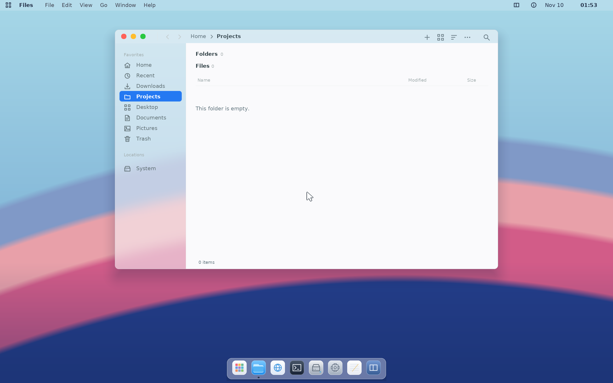

# Coast desktop

Source repository: https://github.com/camden-pina/ModernOS.git.
Build Coast with `make iso`, start it with `make run`, and enter `gui` at the
Coast console. See [host setup](host-setup.md).

## Applications and navigation

The native desktop supplies Files, Text Editor, Terminal, Settings and Disks.
Coast includes Chromium, Code OSS, Brine, Qt 6 Demo and the QEMU
runtime/viewer. Additional applications and native build kits are installed
from a configured signed package repository.

| Shortcut | Action |
| --- | --- |
| Super+Space | Open Spotlight and search applications |
| Super+B | Open Chromium |
| Super+E | Open Files |
| Super+T | Open Terminal |
| Alt+Space | Open window actions |
| Ctrl+Alt+M | Open the focused native application's menu bar |
| Ctrl+Alt+Escape | Return to the console after resolving unsaved documents |

The menu bar follows the focused application. File, Edit, View and Go expose
that application's operations; Window manages windows/workspaces and Help
lists supported keys. Alt+F/E/V/G/W/H selects native application menus.
Terminal keeps its application key bindings; Ctrl+Alt+M opens its menus.

Windows support focus, stacking, dragging, resizing, minimize/restore,
maximize/restore, snapping and workspaces. Title bars remain reachable when
moving windows across screen edges. Closing a document with unsaved changes
asks for a save or discard. Cancelling leaves the application running.

The Dock launches applications and restores their running windows. Spotlight
searches installed applications. Native dialogs, menus and lists accept real
keyboard, pointer and wheel input.

## Files and documents

Files reads the kernel VFS with normal directory and metadata syscalls.
Create, rename, move, copy, delete, trash and document operations run with the
active profile's filesystem credentials. Text Editor supports UTF-8 text,
selection, editing, undo/redo, search, file open/save and shared text clipboard
operations. Unsupported filesystem mutations return errors.

Disks reports the actual kernel device/partition inventory, capacity, sector
size, parent, access and mount information. It does not provide partitioning,
formatting, repair or erase operations. Missing capacity usage or identifiers
are shown as unavailable.

## Terminal and accounts

The desktop uses source-built Bash/Readline with pipes, command and
process substitution, redirections and foreground/background jobs. Terminal
provides the PTY, scrollback, selection/copy, paste and profile preferences.

The console and Terminal start as the active ordinary account. Set the owner
password in Settings → Profiles before using sudo or creating more accounts.
Profiles have private homes, stable UID/GID values and standard/administrator
roles. The trusted desktop broker authorizes operations for the signed-in
profile; ordinary applications retain their own credentials. Switching profiles
closes that profile's application sessions and clears the clipboard. Chromium
and Code OSS currently run in the owner profile. See [accounts](accounts.md).

## Appearance, input and clipboard

Settings controls the desktop theme, appearance, scaling, profiles and Terminal
preferences. UI scales are 100%, 125%, 150% and 200%. The software compositor
uses cached surfaces, damage tracking, clipping, shadows and backdrop blur;
application pixels are not stretched during window resize or layout changes.
The wallpaper, theme and icons are project artwork.

The focused native application uses the shared UTF-8 text clipboard, limited
to 64 KiB. Clipboard access follows native window ownership/focus and profile
permissions. Chromium, Code OSS and Qt integrate through their respective
brokers/backends. See [input and clipboard](input-and-clipboard.md).

## Development and limits

`gui --info` reports display capabilities without taking the display.
`gui --stats` records compositor/presentation statistics on exit; `gui --trace`
records application/window actions for guest tests. The desktop, Qt, browser,
editor and nested VM suites operate actual guest windows with USB input.

Coast runs as a RAM-backed live system. Persist files on a supported writable
mount before shutdown. Hardware, filesystem, application and website support
is bounded by the implemented kernel interfaces and the tested ports. The
native desktop is a software-rendered userspace desktop; generic GPU APIs,
arbitrary Linux desktops and broad application compatibility are not implied.
