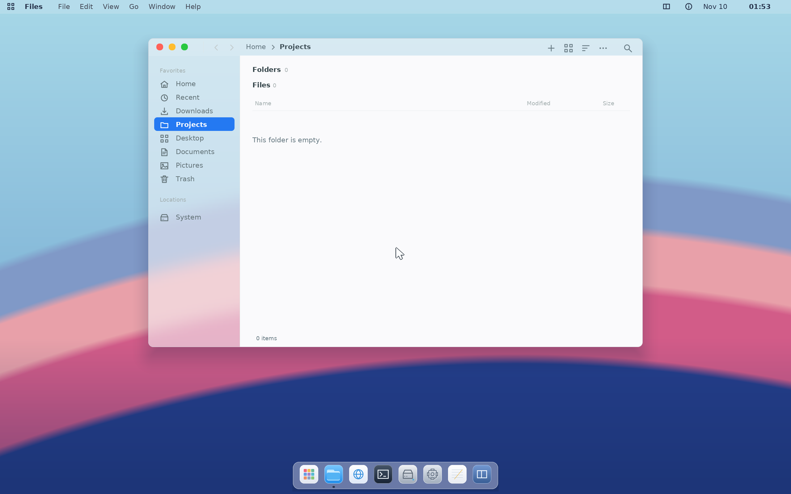

# Coast

Coast is an experimental x86-64 operating system with its own kernel, native
desktop, account system and Linux-compatible application ABI. It runs Chromium,
Code OSS and native development tools inside Coast.

[GitHub repository](https://github.com/camden-pina/ModernOS)



## Build and run

Use an **x86-64 Linux host with Git and Python 3.12+**. On Ubuntu 24.04, run:

```sh
git clone https://github.com/camden-pina/ModernOS.git coast
cd coast
python3 -B tools/setup_host.py --install
make menuconfig
make iso
make run
```

The setup helper explicitly installs host dependencies with sudo, including the
checksum-verified Chromium prerequisite installer. Run it once as your normal
user. The build fetches pinned upstream sources and uses rootless Podman and
Bubblewrap. [Host setup](Documentation/host-setup.md) covers other distributions,
required namespaces and inspecting the setup commands before installation.

The ISO is **`build/coast/image/Coast.iso`**. Rerun `make iso` to resume
completed stages. Electron/Chromium is a large
source build: reserve more than 100 GB for it plus space for the other build
trees. The desktop VM uses 16 GiB RAM. QEMU uses KVM when available and falls
back to slower software emulation.

`make iso` builds the complete desktop: the kernel, native desktop and account
tools, Chromium, Code OSS, GCC/G++, Python, Coast Packages/makepkg, Qt Widgets,
QEMU and the Chromium VM viewer. `make run` boots that ISO without rebuilding.
[Optional arguments](Documentation/build-system.md) cover build parallelism,
output directories, VM settings and developer workflows.

The terminal wizard saves build and VM choices in `.config`. Reopen it with
`make menuconfig`; later Make commands load the saved settings automatically.
`make iso` also works with defaults before a configuration is saved.

For GitHub Download ZIP, extract it and run `git init` in the extracted folder
before building. A Coast source archive already includes its source inventory.

## Use Coast

Enter `gui` at the Coast console. Super+B opens Chromium, Super+T Terminal and
Super+E Files. Super+Space opens Spotlight; use it to launch Code OSS, Coast
Packages, Qt 6 Demo and the other installed applications. Set the owner password
in Settings → Profiles before using sudo.

Coast uses **RAM-backed live storage**. Copy work to a supported writable mount
before shutdown to keep files, passwords and configuration.

Coast builds source recipes with makepkg/fakeroot. To download signed
packages, obtain a server URL, public key and independently verified full
fingerprint from your repository operator, then run inside Coast:

```sh
coast configure https://packages.example.org --key ./repository.asc --fingerprint FULL_40_CHARACTER_FINGERPRINT
coast server --check
coast refresh
```

The example URL is a placeholder for your package service. Repository hosting
and community setup are described in [Coast Packages](Documentation/local-repositories.md).
A source build requires no package server or private signing key.

## Development

Git contains source, patches, editable configuration, artwork, license notices
and pinned download manifests. Generated programs, ISOs, downloads and private
state stay in ignored local directories.

```sh
make source-check test-source-tree test-source-fetch test-desktop-assembly
python3 -B tools/test_package_configuration.py
```

The integrated desktop has passed all 11 guest qualification phases, including real
package transactions, Qt input/clipboard and nested QEMU through Chromium/noVNC.
Source-export component builds pass UEFI/BIOS boot checks. Qualification reuses
verified source-built Electron/Node components; an empty full Electron graph
build is not yet verified end to end. [Source builds](Documentation/source-builds.md)
records the precise coverage and remaining prebuilt inputs.

See [the build guide](Documentation/build-system.md), [desktop](Documentation/desktop.md),
[browser](Documentation/chromium-browser.md), [accounts](Documentation/accounts.md),
[Qt](Documentation/qt6.md), [QEMU](Documentation/qemu.md),
[contributing](CONTRIBUTING.md) and [licenses](LICENSES.md).
[Cache cleanup](Documentation/repository-cleanup.md) explains how to inspect
and remove regenerable local caches.
